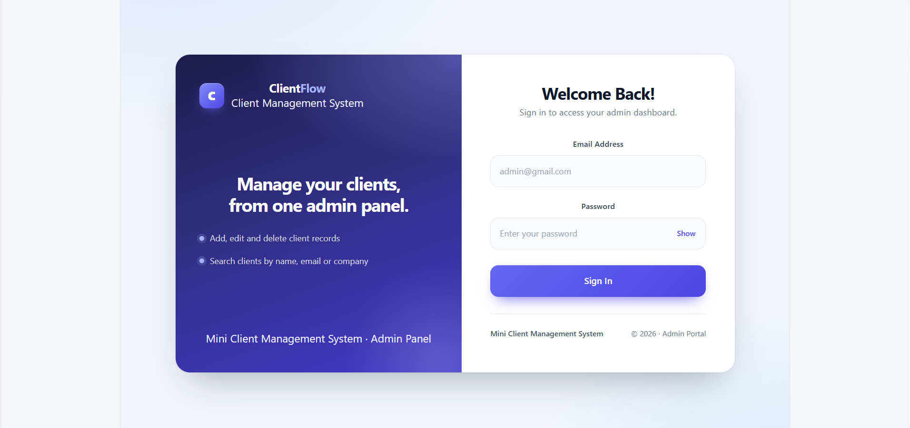

# Mini Client Management System

## Project Overview

-> The Mini Client Management System is a full-stack web application developed to manage client information efficiently.

-> It allows administrators to log in securely, view client statistics, and manage client records through a user-friendly dashboard.

## Features

### 1. Authentication

* User login functionality.
* JWT-based authentication.
* Protected dashboard access.

### 2. Dashboard

* Display total clients.
* Display active clients.
* Display inactive clients.
* Navigation between dashboard and client management.

### 3. Client Management

* Add new client details.
* View registered clients.
* Edit existing client information.
* Delete client records.
* Search clients by name, email, and company.

### 4. Form Validation

* Required field validation.
* Email format validation.
* Phone number validation.
* Success and error messages.

### 5. Responsive Design

* User-friendly interface.
* Responsive layout for desktop, tablet, and mobile devices.

## Technologies Used

### Frontend
- React.js
- HTML
- CSS
- JavaScript
- Bootstrap

### Backend
- Node.js
- Express.js

### Database
- MongoDB

### Authentication
- JWT (JSON Web Token)

### Tools
- Visual Studio Code
- Postman
- MongoDB Atlas
- Git and GitHub

## Project Folder Structure

client-management-system/
│
├── backend/
│   ├── config/
│   │   └── db.js
│   ├── middleware/
│   │   └── authMiddleware.js
│   ├── models/
│   │   ├── Client.js
│   │   └── User.js
│   ├── routes/
│   │   ├── authRoutes.js
│   │   └── clientRoutes.js
│   ├── .env
│   ├── package.json
│   ├── resetPassword.js
│   └── server.js
│
├── frontend/
│   ├── public/
│   ├── src/
│   │   ├── api/
│   │   │   └── axios.js
│   │   ├── assets/
│   │   ├── components/
│   │   │   └── ProtectedRoute.jsx
│   │   ├── context/
│   │   │   └── AuthContext.jsx
│   │   ├── pages/
│   │   │   ├── Clients.css
│   │   │   ├── Clients.jsx
│   │   │   ├── Dashboard.css
│   │   │   ├── Dashboard.jsx
│   │   │   ├── Login.css
│   │   │   └── Login.jsx
│   │   ├── App.css
│   │   ├── App.jsx
│   │   ├── index.css
│   │   └── main.jsx
│   ├── eslint.config.js
│   ├── index.html
│   ├── package.json
│   └── vite.config.js
│
└── .gitignore

## Installation and Setup

### 1. Clone the Repository

git clone <your-github-repository-url>

### 2. Backend Setup

cd backend

npm install

npm run dev

### 3. Frontend Setup

cd frontend

npm install

npm run dev

### 4. Environment Variables

Create a .env file inside the backend folder.

Add the following variables:

PORT=5000

MONGO_URI=mongodb+srv://<username>:<password>@<cluster-url>/<database-name>

JWT_SECRET=your_secret_key

# Login 

# Dashboard

# ADD Client

# UPDATE Client

 
# DELETE Client

# Database

